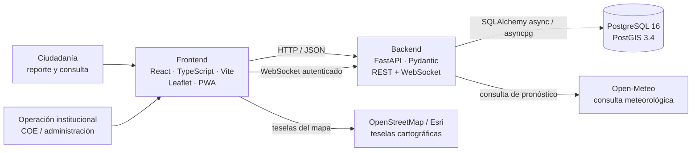

# Esmeraldas Resiliente

<p align="center">
  <strong>Plataforma web académica para visualizar información territorial y coordinar una respuesta demostrativa ante emergencias.</strong>
</p>

<p align="center">
  <a href="https://github.com/yeronpool123/esmeraldas-resiliente-hackathon2026-utelvt"></a>
  
  
  
  
  
  
  
  
</p>

> **Uso académico y demostrativo.** No es un sistema oficial de gestión de emergencias, no reemplaza los canales del ECU 911, la SNGR, el INAMHI ni de los organismos competentes, y sus datos de ejemplo no deben utilizarse para tomar decisiones reales.

## Descripción

Esmeraldas Resiliente es una aplicación web concebida como prototipo de apoyo para consultar capas cartográficas, visualizar zonas de riesgo, reportar incidentes y solicitudes de ayuda, y representar flujos de coordinación para albergues y asistencia humanitaria. Integra una interfaz para la ciudadanía con vistas de operación para perfiles institucionales.

La solución se organiza en tres componentes desplegables: una aplicación frontend, una API asíncrona y una base de datos geoespacial. La información de ejemplo está pensada para demostrar la experiencia y los flujos funcionales; no constituye un inventario oficial ni una fuente validada de alertas.

## Tecnologías

<p>
  <a href="https://skillicons.dev"></a>
</p>

| Área | Tecnología | Función en el proyecto |
|---|---|---|
| Interfaz | React 19, TypeScript 7 | Aplicación modular, componentes y tipado estático. |
| Desarrollo frontend | Vite 8 | Servidor de desarrollo y compilación para producción. |
| Estilos e interacción | Tailwind CSS 4, CSS, Motion, Lucide React | Diseño adaptable, transiciones e iconografía de interfaz. |
| Cartografía | Leaflet | Presentación e interacción con el mapa y las capas. |
| API | Python 3.14, FastAPI, Uvicorn | API HTTP asíncrona y canal WebSocket operativo. |
| Persistencia | SQLAlchemy 2 async, asyncpg | Acceso asíncrono a PostgreSQL. |
| Datos geoespaciales | PostgreSQL 16, PostGIS 3.4, GeoAlchemy2 | Almacenamiento y consultas espaciales en SRID 4326. |
| Validación y configuración | Pydantic, pydantic-settings | Validación de solicitudes y configuración del backend. |
| Seguridad de API | PyJWT, bcrypt, SlowAPI | Tokens, hash de contraseñas y límites de solicitudes. |
| Contenedores | Docker, Docker Compose | Entorno local integrado de frontend, API y base de datos. |
| Aplicación web instalable | Web App Manifest, Service Worker | Metadatos de instalación y caché del shell de la aplicación. |

Los iconos ilustran el stack y enlazan con el catálogo de [Skill Icons](https://skillicons.dev); los badges se generan con [Shields.io](https://shields.io/).

## Arquitectura en una vista



La arquitectura, sus componentes, las decisiones técnicas, el modelo de datos y los diagramas ampliados están en [docs/ARQUITECTURA.md](docs/ARQUITECTURA.md). La guía de instalación se encuentra en [docs/SETUP.md](docs/SETUP.md).

## Capacidades del prototipo

- **Mapa y capas territoriales:** zonas de riesgo, ríos, vías, servicios esenciales, incidentes y albergues.
- **Reporte ciudadano y SOS:** captura de coordenadas, validación de datos, cola local de solicitudes y sincronización idempotente mediante identificador de cliente.
- **Operación institucional:** acceso por rol, consulta y actualización de incidentes, alertas, vías, albergues y recursos de asistencia.
- **Información pública:** resumen de SOS con ubicación aproximada; las coordenadas exactas están reservadas a perfiles institucionales autenticados.
- **Actualizaciones operativas:** canal WebSocket autenticado para difundir eventos a operadores conectados.
- **Priorización experimental:** puntuación heurística en el frontend para ordenar incidentes con factores visibles.
- **Experiencia web instalable:** manifest y caché del shell estático. La API y sus datos no se vuelven offline por esta caché.

La información meteorológica se solicita mediante el backend a Open-Meteo. El mapa utiliza Leaflet con teselas de OpenStreetMap y un mapa satelital de Esri. Consulta los términos y políticas de cada proveedor antes de publicar o escalar el servicio.

## Módulos de la aplicación

| Módulo | Propósito |
|---|---|
| M1 · Mapa de riesgo | Explorar capas, incidentes, albergues y contexto territorial. |
| M2 · Reporte ciudadano | Registrar un incidente desde la perspectiva de la ciudadanía. |
| M3 · Dashboard COE | Revisar estado operativo e indicadores de coordinación. |
| M4 · Albergues y evacuación | Visualizar capacidad y flujos demostrativos de evacuación. |
| M5 · Ayuda humanitaria | Representar familias afectadas, necesidades, inventario y entregas. |
| M6 · Priorización predictiva | Mostrar una puntuación explicable de prioridad, con fin académico. |

## Inicio rápido

Requisitos: Git, Node.js 22 o superior, npm y Docker Desktop con Docker Compose. Para el modo de contenedores, configura primero las variables locales siguiendo [docs/SETUP.md](docs/SETUP.md); nunca compartas ni subas el `.env`.

```powershell
git clone https://github.com/yeronpool123/esmeraldas-resiliente-hackathon2026-utelvt.git
cd esmeraldas-resiliente-hackathon2026-utelvt
Copy-Item .env.example .env
# Edita .env con secretos y claves locales seguras antes de iniciar los contenedores.
docker compose up --build
```

Servicios locales:

| Componente | Dirección |
|---|---|
| Aplicación web | http://localhost:3000 |
| API | http://localhost:8000 |
| Documentación interactiva de FastAPI | http://localhost:8000/docs |
| Verificación de salud | http://localhost:8000/api/health |
| PostgreSQL/PostGIS | `localhost:5433` |

Para instrucciones detalladas, configuración de cuentas, inicio del backend fuera de Docker, resolución de problemas y precauciones de datos, consulta [docs/SETUP.md](docs/SETUP.md).

## Verificaciones de desarrollo

```powershell
npm ci
npm run lint
npm run build
```

Pruebas del backend (desde la raíz, con el entorno Python configurado según la guía):

```powershell
python -m pytest backend/tests
```

`npm run lint` ejecuta el chequeo de TypeScript (`tsc --noEmit`). El conjunto de pruebas backend cubre seguridad de API y servicios públicos. Estas comprobaciones no equivalen a una certificación de seguridad ni a pruebas de aceptación operativa.

## Seguridad, privacidad y límites

- Los secretos se configuran localmente con `.env`; `.env.example` contiene valores instructivos, no credenciales de despliegue.
- La API valida entradas y roles, aplica limitación de solicitudes en rutas sensibles y registra auditoría en cambios operativos.
- Las coordenadas exactas de SOS requieren autenticación institucional en la API; el listado público retorna una ubicación aproximada.
- La cola de SOS del navegador se conserva en `localStorage`; no es almacenamiento cifrado ni debe contener datos sensibles innecesarios.
- Los datos semilla y las métricas de ejemplo son demostrativos. La puntuación de prioridad es lógica heurística y no un modelo ML entrenado o validado.
- La aplicación presenta advertencias para dejar claro que un reporte por este prototipo no contacta por sí solo con los servicios oficiales.
- Antes de cualquier uso real se requieren revisión de seguridad, protección de datos, evaluación de accesibilidad, pruebas de carga, continuidad, monitoreo, respaldo y aprobación institucional.

## Participación y experiencia

Este proyecto se desarrolló en el contexto del **Hackathon Esmeraldas Resiliente 2026 de la UTELVT**. Participé como graduado invitado por el **Ing. Fabián Caicedo Goyes**; acepté el reto e intervine en el desarrollo junto con el equipo.

La experiencia de trabajo en los Laboratorios de TICs fue especialmente motivadora. Se construyó un ambiente colaborativo y de grupo, con dinámicas que se sentían cercanas a las de una empresa real de desarrollo e ingeniería de software: cada integrante trabajaba a su ritmo, se hacían pequeños recesos y se compartían avances con Git, GitHub y GitHub Desktop. Para mí fue una vivencia maravillosa y nostálgica: volver a rodearme de un ecosistema de desarrollo web, software e ingeniería me gustó muchísimo y reforzó mi motivación por seguir construyendo tecnología en equipo.

## Estructura del repositorio

```text
.
├── backend/          # API FastAPI, modelos, seguridad, routers y pruebas
├── database/         # Esquema PostGIS, datos semilla y consultas de verificación
├── docs/             # Guía de instalación y arquitectura con diagramas
├── documentacion/    # Material técnico complementario del proyecto
├── public/           # Recursos estáticos, manifest y service worker
├── scripts/          # Ayudantes locales de desarrollo
└── src/              # Aplicación React, módulos, componentes y estado
```

## Documentación

- [Arquitectura de software y diagramas](docs/ARQUITECTURA.md)
- [Instalación, configuración y ejecución](docs/SETUP.md)
- [Documentación técnica integral complementaria (PDF)](documentacion/Documentacion_Tecnica_Integral_Esmeraldas_Resiliente_2026.pdf)
- [Repositorio en GitHub](https://github.com/yeronpool123/esmeraldas-resiliente-hackathon2026-utelvt)

---

<p align="center">
  Desarrollado como prototipo académico colaborativo para el Hackathon Esmeraldas Resiliente 2026 · UTELVT.
</p>
