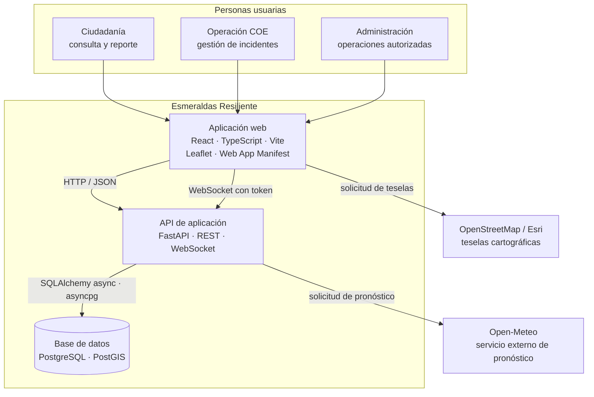
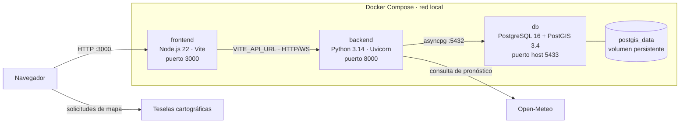
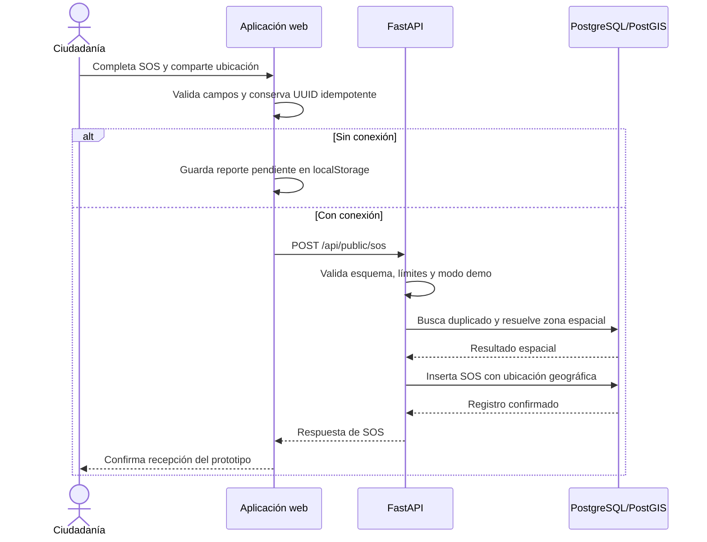
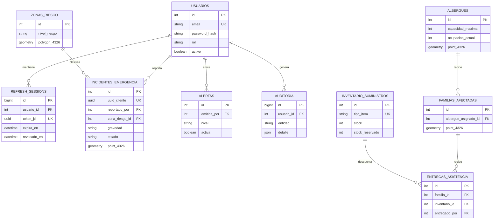

# Arquitectura de software

| Campo | Descripción |
|---|---|
| Proyecto | Esmeraldas Resiliente |
| Contexto | Hackathon Esmeraldas Resiliente 2026 · UTELVT |
| Tipo | Prototipo web académico, demostrativo y modular |
| Estado | Descripción de la implementación presente en este repositorio |

> La arquitectura facilita una demostración técnica de coordinación y visualización territorial. No es una plataforma oficial de emergencias ni está certificada para operar en una emergencia real.

## 1. Objetivos y alcance arquitectónico

El diseño busca:

1. Ofrecer una aplicación accesible desde navegador para perfiles ciudadanos e institucionales.
2. Separar interfaz, lógica de API y persistencia para que puedan desarrollarse y desplegarse como servicios distintos.
3. Modelar información geográfica de forma nativa y consultar relaciones espaciales.
4. Proteger las operaciones institucionales mediante autenticación, roles, límites y trazabilidad.
5. Hacer demostrables los flujos de SOS y operación con datos de escenario, sin confundirlos con información oficial.

No se incluyen garantías de disponibilidad, monitoreo de producción, alta disponibilidad de base de datos, protección integral de datos personales, interoperabilidad institucional o recuperación ante desastres. Esas capacidades requieren diseño, infraestructura y validación adicionales.

## 2. Modelo C4 simplificado: contexto y contenedores



### Contenedores y responsabilidades

| Contenedor | Responsabilidades | Tecnologías |
|---|---|---|
| Frontend | Interfaz, navegación por módulos, mapa, validación de formularios, estado de sesión y cola local de SOS. | React, TypeScript, Vite, Leaflet, CSS/Tailwind, Motion, Lucide React. |
| API | Autenticación, autorización, validación de entrada, consultas y cambios de dominio, servicios públicos, salud, límites de solicitudes y eventos operativos. | Python, FastAPI, Pydantic, SQLAlchemy async, Uvicorn, SlowAPI. |
| Base de datos | Usuarios y sesiones de renovación, datos operativos y geometrías espaciales. | PostgreSQL, PostGIS. |
| Dependencias externas | Pronóstico consultado por el backend y teselas consumidas por el cliente cartográfico. | Open-Meteo y proveedor de teselas configurado. |

Los servicios `frontend`, `backend` y `db` se definen en `compose.yaml`. El frontend y el backend tienen Dockerfiles propios. El esquema y los datos semilla se montan en PostgreSQL para inicializar una base nueva.

## 3. Diagrama de despliegue local



El `healthcheck` de PostgreSQL espera a `pg_isready`; el backend depende de esa condición de salud y el frontend espera al backend saludable. Estas dependencias simplifican el inicio local, pero no sustituyen una estrategia de orquestación o disponibilidad para producción.

## 4. Componentes de aplicación

### Frontend

- `src/App.tsx`: composición de la aplicación y navegación de vistas.
- `src/context/AppContext.tsx`: estado compartido y coordinación de autenticación, reportes y datos de operación.
- `src/components/modules/`: módulos funcionales M1–M6.
- `src/components/map/`: vista cartográfica y widgets relacionados.
- `src/lib/`: persistencia local, permisos, geografía, sesión demostrativa y puntuación experimental.
- `public/service-worker.js`: caché del app shell y recursos estáticos same-origin; excluye solicitudes `/api/`.

El mapa se presenta en Leaflet. El Service Worker ayuda a servir la interfaz cuando no hay red después de cargar y guardar recursos, pero no hace que los endpoints ni la base de datos estén disponibles sin conexión. La cola de SOS se almacena en `localStorage`, con las limitaciones de seguridad y capacidad propias del almacenamiento del navegador.

### Backend

FastAPI compone routers por área de dominio:

| Área | Rutas principales documentadas |
|---|---|
| Salud | `GET /api/health` |
| Autenticación | `/api/auth/login`, `/refresh`, `/logout`, `/me` |
| Incidentes | `/api/incidentes` |
| SOS y servicios públicos | `/api/public/config`, `/sos`, `/sos/exact`, `/weather` |
| Zonas y cartografía | `/api/zonas`, `/api/capas/vias`, `/rios`, `/servicios` |
| Vías | `/api/vias` |
| Albergues | `/api/albergues` |
| Alertas | `/api/alertas` |
| Asistencia | rutas `/api/familias`, `/api/necesidades-pendientes`, `/api/inventario`, `/api/entregas` |
| Indicadores | `/api/kpis/resumen` |
| Tiempo real | `WS /ws/operaciones` |

FastAPI publica el esquema OpenAPI y Swagger UI en `/docs` durante la ejecución local. Las rutas pueden evolucionar; la especificación generada por la instancia ejecutándose es la referencia operativa.

## 5. Flujos representativos

### 5.1 Reporte SOS público



La API limita esta ruta a `3/5minutes`, verifica el identificador de cliente para evitar duplicados, y usa `ST_Within` para asignar una zona cuando corresponde. El SOS ciudadano es un registro de la aplicación: no equivale a una llamada o aviso a los servicios oficiales.

El endpoint público de consulta redondea las coordenadas y marca la ubicación como aproximada. El endpoint de ubicación exacta `/api/public/sos/exact` requiere un rol `OPERADOR_COE` o `ADMIN`. La API establece `Cache-Control: no-store` en estas consultas.

### 5.2 Autenticación institucional

1. El cliente envía identificador, contraseña, rol y, para operadores, entidad.
2. La API aplica validación de esquema y límite de intentos en el endpoint de login.
3. Se comprueba el hash de contraseña, el estado del usuario, su rol y los intentos fallidos.
4. Al autenticar se emite un token de acceso y un token de renovación registrado en `refresh_sessions`.
5. La API puede renovar y revocar sesiones; las rutas protegidas validan el token y las dependencias de rol.
6. El canal `/ws/operaciones` recibe un token al conectarse y permite únicamente perfiles operativos autorizados.

La configuración rechaza secretos JWT débiles o repetidos y contraseñas de rol que no cumplan las reglas definidas. Las claves reales se deben crear localmente y nunca versionarse.

### 5.3 Eventos en tiempo real

El hub `OperationsHub` mantiene conexiones WebSocket dentro del proceso backend y difunde los cambios a las conexiones activas. No es un bus distribuido: con varias réplicas, cada proceso mantendría su propio conjunto de conexiones. Para escalar horizontalmente habría que incorporar un broker o mecanismo pub/sub compartido.

## 6. Modelo de datos y geoespacial

Las definiciones de `database/01_schema_postgis.sql` y los modelos de `backend/app/models.py` describen las tablas de aplicación. El siguiente ERD resume los vínculos principales; se omiten atributos y algunas tablas auxiliares para mantenerlo legible.



### Criterios de persistencia

- Geometrías geográficas en SRID 4326: puntos para incidentes, albergues, familias y servicios; líneas para vías e hidrografía; polígonos para zonas.
- Índices GiST para geometrías y B-tree para filtros operativos de estado, gravedad, fechas y sesión.
- Restricciones de integridad para estados, roles, cantidades, capacidad de albergues y stock.
- UUID de cliente único en incidentes para tolerar reintentos de sincronización.
- JSONB de auditoría para guardar detalles de cambios sin duplicar columnas por cada tipo de acción.
- Datos semilla separados del esquema y claramente demostrativos.

Las operaciones espaciales del backend incluyen la conversión de geometrías a GeoJSON y la asignación de zona mediante `ST_Within`. El frontend usa teselas estándar de OpenStreetMap y un servicio de imágenes satelitales de Esri; deben respetarse sus atribuciones y condiciones de uso. La aplicación debe validar origen, licencia, actualidad y precisión de los datos cartográficos antes de cualquier uso institucional.

El manifiesto de dependencias incluye `@google/genai`, pero el código fuente del frontend no importa ese SDK. No forma parte de una integración activa descrita por esta arquitectura.

## 7. Stack y justificación técnica

| Decisión | Justificación en este proyecto | Consideración |
|---|---|---|
| React + TypeScript | Componentes reutilizables para módulos y tipado estático para las estructuras de interfaz. | Conviene mantener tipos de API explícitos y probar los flujos críticos. |
| Vite | Iteración local rápida y salida estática para servir el frontend. | El Dockerfile actual inicia Vite en modo desarrollo; el despliegue de producción debe servir una compilación optimizada. |
| FastAPI async | API HTTP validada con OpenAPI y handlers asíncronos para base de datos y servicios externos. | Las dependencias compartidas y los límites de recursos requieren configuración de producción. |
| PostgreSQL + PostGIS | Datos relacionales con restricciones y primitivas espaciales maduras. | Para producción se requiere respaldos, migraciones controladas y monitoreo. |
| SQLAlchemy async + asyncpg | Acceso asíncrono con modelos y consultas expresivas. | Dimensionar pools según la base y el número de procesos de API. |
| Docker Compose | Entorno local reproducible de tres servicios con salud y volumen persistente. | Compose local no proporciona despliegue de alta disponibilidad ni gestión de secretos. |
| WebSocket | Difusión de cambios de operación a clientes autenticados conectados. | El hub actual vive en memoria en un solo proceso. |
| PWA | Instalación y acceso al shell previamente almacenado. | La caché no incluye API, autenticación ni datos dinámicos offline. |

### Priorización experimental

`src/lib/aiModel.ts` implementa una **heurística determinista** de prioridad en el cliente basada en tipo de evento, personas afectadas, nivel de riesgo de zona y precipitación de entrada. Devuelve score, nivel y factores explicativos. Es una herramienta de demostración, no un clasificador entrenado que se ejecute en el backend.

El archivo también contiene métricas descriptivas y referencias a un algoritmo Random Forest. Esos valores no están conectados a un artefacto de modelo entrenado, a un pipeline de inferencia ni a una evaluación reproducible en este repositorio; por tanto, **no deben interpretarse como resultados verificados ni como capacidad operativa**. No usar la puntuación para asignar recursos reales o sustituir el criterio de autoridades.

## 8. Seguridad y privacidad

Controles presentes en la implementación:

- Hash de contraseñas con bcrypt y secretos provistos desde variables de entorno.
- Tokens JWT de acceso y renovación; registro y revocación del identificador de refresh en base de datos.
- Validación de credenciales, rol y estado de cuenta; selección de entidad para el rol COE.
- Bloqueo temporal después de repetidos intentos de inicio de sesión.
- Límites de solicitudes con SlowAPI en endpoints sensibles.
- Autorización por dependencias de roles para acciones institucionales y para datos exactos de SOS.
- CORS con orígenes configurados por entorno.
- Auditoría de acciones operativas presentes en los flujos de escritura.
- Coordenadas públicas aproximadas separadas del acceso institucional a ubicación precisa.
- `.env` ignorado por Git y `.env.example` sin secretos válidos.

Requisitos antes de desplegar para usuarios reales:

1. HTTPS obligatorio y política de cookies/tokens adecuada al modelo de amenaza.
2. Gestión de secretos del entorno de despliegue, rotación y eliminación de credenciales de demostración.
3. Revisión externa de autenticación, autorización, abuso de endpoints, privacidad, CORS y dependencias.
4. Políticas de acceso, retención, consentimiento y minimización para ubicación e información personal.
5. Logs estructurados con redacción de datos sensibles, métricas y alertas.
6. Respaldo probado, recuperación, migraciones versionadas y pruebas de restauración.
7. Pruebas de carga, concurrencia, disponibilidad y recuperación de WebSockets.
8. Revisión legal, institucional, de accesibilidad y de protocolos oficiales de emergencia.

## 9. Calidad y validación

Comandos de validación frontend:

```powershell
npm ci
npm run lint
npm run build
```

Pruebas backend:

```powershell
python -m pytest backend/tests
```

Las pruebas existentes verifican casos de seguridad API y servicios públicos. Los resultados deben revisarse en el entorno que se vaya a usar; un build exitoso no certifica seguridad, exactitud cartográfica ni idoneidad operativa.

## 10. Estructura relevante

```text
src/
  components/       Interfaz, módulos, mapa, bienvenida y autenticación
  context/          Estado compartido y flujos de aplicación
  data/             Datos iniciales de demostración
  lib/              Geografía, permisos, cola, almacenamiento y score experimental
  types/            Tipos compartidos del frontend
backend/
  app/core/         Configuración y carga de entorno
  app/routers/      Endpoints agrupados por dominio
  db.py             Engine y sesiones SQLAlchemy async
  models.py         Modelos PostgreSQL/PostGIS
  security.py       JWT, contraseñas, dependencias de sesión/roles
  realtime.py       Hub WebSocket en memoria
  tests/            Pruebas backend
database/           Esquema PostGIS, seed y consultas de verificación
docs/               Guías, arquitectura y diagramas
```

## 11. Experiencia de colaboración

El trabajo se realizó como parte del Hackathon Esmeraldas Resiliente 2026 de la UTELVT. El autor participó como graduado invitado por el Ing. Fabián Caicedo Goyes y aceptó el reto. El desarrollo compartido en los Laboratorios de TICs se caracterizó por un ambiente de colaboración, trabajo en equipo y autonomía: cada persona avanzaba a su ritmo, se hacían pequeños recesos y se compartían avances usando Git, GitHub y GitHub Desktop.

La experiencia se vivió como un entorno real de desarrollo e ingeniería de software. Fue motivadora, nostálgica y personalmente maravillosa; volver a estar rodeado de desarrollo web, software e ingeniería reforzó el interés por construir soluciones en equipo.

## 12. Referencias de implementación

- [Guía de instalación y ejecución](SETUP.md)
- [README del proyecto](../README.md)
- [Esquema de base de datos](../database/01_schema_postgis.sql)
- [Composición de servicios](../compose.yaml)
- [Routers FastAPI](../backend/app/routers/)
- [Repositorio GitHub](https://github.com/yeronpool123/esmeraldas-resiliente-hackathon2026-utelvt)
